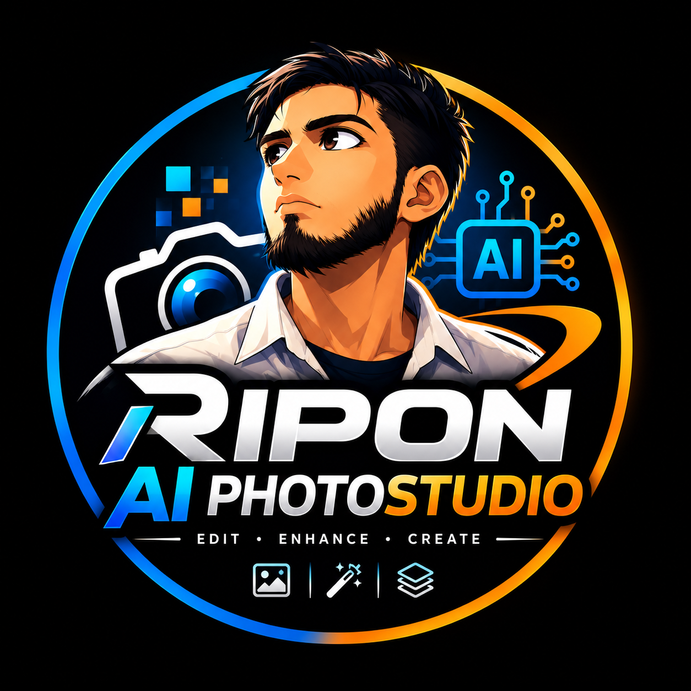

<p align="center">
  
</p>

<h1 align="center">RIPON AI PHOTO STUDIO</h1>
<p align="center"><b>EDIT &nbsp;·&nbsp; ENHANCE &nbsp;·&nbsp; CREATE</b></p>

A Windows program for photo studios and computer shops: passport / ID photos, AI photo tools, document scanning, print layouts, customer jobs and daily accounts, all in **one window**.

---

## Download (Windows 10/11)

**[Download Ripon AI Photo Studio 4.0](https://github.com/thestartinglightofearth/Ripon-Computer-Studio/releases/tag/4.0)**

1. Open the link above and scroll down to **Assets**.
2. Download the file and double-click it.
   - If it is a **Setup** file, follow the steps and finish the install.
   - If it is just `RiponAIPhotoStudio.exe`, it runs directly. No install needed.
3. Start **Ripon AI Photo Studio**. It opens in full screen.

No other software is needed.

**If Windows shows "Windows protected your PC":** click **More info**, then **Run anyway**. This message appears because the program is not code-signed. Some antivirus programs may also warn about it. This is a false alarm.

The first start can take a little longer. This is normal.

---

## What is inside

Everything is in one window. Use the menu on the left to change pages.

| Page | What it does |
|---|---|
| **Home** | Start page: Open Photo, Scan Document, and a card for every tool |
| **Photo Studio** | Passport / ID photo: background, crop, retouch, print sheet |
| **AI Studio** | Upscale, face restore, object removal, cut-out, old photo repair |
| **Document Studio** | Scan and clean documents, ID copy, many pages to one PDF |
| **Layout Studio** | Multi-page layouts, Bank Photo Duet, ID card, passport sheet, exact-size print, PDF export |
| **Customer Jobs** | Customers, services and saved work |
| **Accounts** | Income and expenses |
| **AI Models / GPU** | Manage AI models and GPU use |

---

## Tips

- The program starts in full screen. Use the buttons at the top right to minimize, switch full screen on/off (`Ctrl+Shift+F`), or close.
- The ☰ button (top-left) hides or shows the left menu.
- Your original photos are never overwritten. Crops and fixes are saved as new files.
- Your work is autosaved. After a crash, the program offers to restore it.
- When printing, choose the same paper size in the printer window and print at **Actual size / 100%**.

---

## Your data

Settings, customer jobs, accounts and AI models are stored in:

```
%LOCALAPPDATA%\RiponComputer\
```

Uninstalling the program does **not** delete this folder. Copy it to keep a backup or to move to another PC.

---

© Ripon
